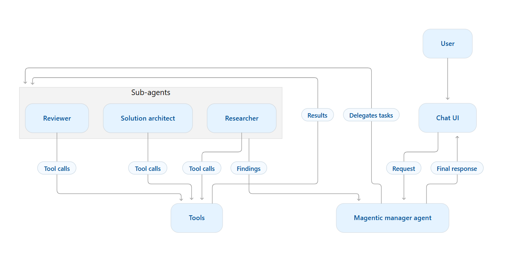

# Magentic agent chat UI

A local Gradio chat app built with Microsoft's Agent Framework Magentic orchestration. A manager coordinates research, solution-architecture, and risk-review agents. The UI shows the final answer in the conversation and streams each participant's output and Magentic planning/progress events in a separate activity panel.

Each submitted chat turn starts a new Magentic workflow. The app includes the recent chat messages in the next task as context.



## Sample test -> Prompt / Task
Create a 90-day pilot plan for a regulated bank using a multi-agent AI system to help customer-service representatives answer credit-card questions. Include the architecture, human approval points, security and privacy controls, evaluation metrics, and key risks. Clearly label assumptions.

## Requirements

- Python 3.11 or newer
- Azure CLI installed
- An Azure OpenAI resource with a chat model deployment
- Microsoft Entra ID access to call that deployment

## Configure Entra ID access

Sign in with the identity the app should use:

```bash
az login
az account set --subscription "YOUR-SUBSCRIPTION-ID"
```

For a tenant-specific login, use `az login --tenant YOUR-TENANT-ID`.

That signed-in identity needs the **Cognitive Services OpenAI User** role on the Azure OpenAI resource for inference. Allow a few minutes for a new role assignment to take effect.

## Install and configure

Run these commands from this directory.

### macOS / Linux

```bash
python3 -m venv .venv
source .venv/bin/activate
python -m pip install --upgrade pip
python -m pip install -r requirements.txt
cp .env.example .env
```

### Windows PowerShell

```powershell
py -3 -m venv .venv
.\.venv\Scripts\Activate.ps1
python -m pip install --upgrade pip
python -m pip install -r requirements.txt
Copy-Item .env.example .env
```

Edit `.env`:

```dotenv
AZURE_OPENAI_ENDPOINT=https://YOUR-RESOURCE.openai.azure.com/
AZURE_OPENAI_CHAT_MODEL=YOUR-DEPLOYMENT-NAME
AZURE_OPENAI_API_VERSION=
```

The model value is the Azure deployment name, not necessarily the model family name. Leave the API version blank to use the client default, or set a version supported by your endpoint's Responses API. No API key is used; `AzureCliCredential` gets tokens from the `az login` session.

## Start the UI

```bash
python main.py
```

Open [http://127.0.0.1:7860](http://127.0.0.1:7860). The app binds to localhost. Each request makes multiple model calls and incurs usage charges for the configured deployment.
